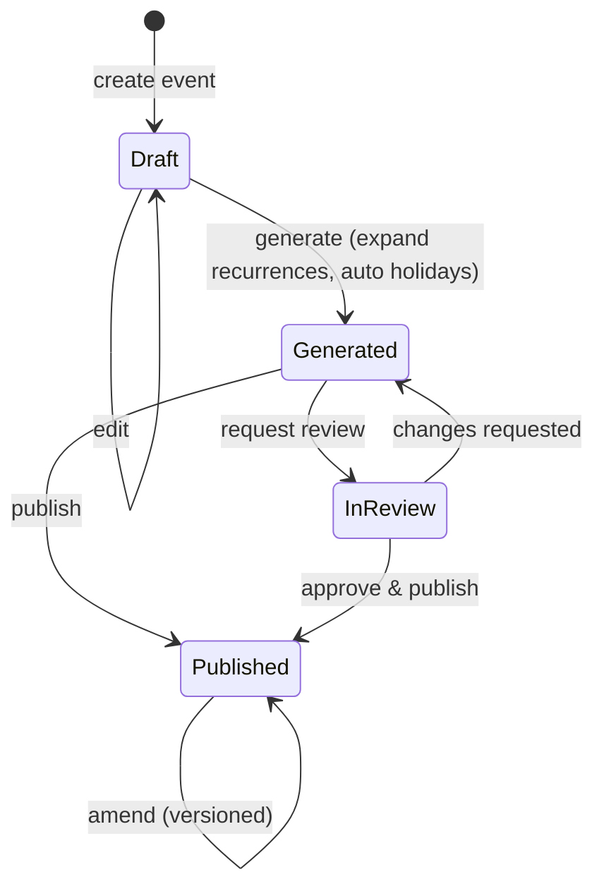

# WF-02 Academic Calendar — generation, review, publishing

| Field | Detail |
|---|---|
| Actors | Academic Ops / ACMS team (create, generate, publish); Principal/Coordinator (review); Teachers, Students, Parents (view) |
| Trigger | Start of an academic session, or ad-hoc event/holiday additions |
| Preconditions | Session year exists; branches mapped to cities; grades and subjects configured; exam types configured |
| Inputs | Event title, description, `event_type` (Holiday, Assessment, Other Event, Competition, Parent-Teacher Meeting, …), date(s), time, recurrence pattern, scope (cities, branches with exclusions, grades, subjects), test type (for assessments), notes, colour |
| Evidence | O: `/erp/acms/calendar` month grid with typed events and filters (branch, grade); `GET /acms/calendar-events/?branch&start_date&end_date&session_year`, `/calendar_status/` → `{is_published, is_generated, draft_events_count, total_events_count}`, `/holiday_range/`; "Reviews" button. S: `/period/calendar-v2/` (monthly), `/period/calendar/` (weekly/daily) |

## Steps
1. Ops user creates the **central** event set for a session (scope: cities/branches/grades/subjects). Events may be recurring (`recurrence_pattern`, `is_recurring_parent`). (S/I)
2. Holidays may be **auto-generated** (`is_auto_holiday`), e.g. Sundays or a statutory list. (O field, I behaviour)
3. Assessment events can link to assessment definitions (`assessment`, `assessment_code`, `test_type`), and assessments can be "scheduled via calendar" (`scheduled_via_calendar`, `calendar_event_id` on the assessment record). (O)
4. Calendar status moves **Draft → Generated → Published** (`is_generated`, `is_published`, `draft_events_count`). (O: the flags; I: the transition order)
5. Reviewers use **Reviews** to comment or approve before publishing. (O button; behaviour I)
6. Branch-level exclusions (`branch_exclusions`) let a branch opt out of a central event. (O field)
7. After publishing, everyone sees events filtered by their branch and grade. Teachers see the calendar as their Academics landing page. (O)

## Business rules
- BR-CAL-1: Events are scoped to the session year; queries are always bounded by `start_date`/`end_date` (month view). (O)
- BR-CAL-2: Event scope resolves to `resolved_branches` from city + branch selections minus exclusions. (O field names, I logic)
- BR-CAL-3: Holidays block attendance and timetable for those days (`week_holidays` in timetable responses). (O field, I linkage)
- BR-CAL-4: Only published events are visible to non-editors. (I)

## State machine
The `InReview` state and review comments are PROPOSED; only the `is_generated`/`is_published` flags and the "Reviews" button were observed (audit ER-32).

## Exceptions
- Overlapping assessment events per grade/subject → warning (PROPOSED).
- Editing a published event that linked assessments depend on → cascade the date change to the assessment's effective date (O field `effective_test_date`, I).

## Related
- Entities: CalendarEvent, EventType, SessionYear, City, Branch, Grade, Subject, Assessment.
- APIs: see `04_BACKEND_ANALYSIS/api_contracts.md#calendar`.
- Permissions: view = all roles in branch; create/edit/publish = Academic Ops (`calendar.event.manage`, `calendar.publish`).
