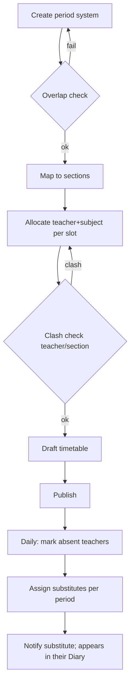

# WF-03 Timetable — period system, allocation, publishing, substitution

| Field | Detail |
|---|---|
| Actors | Timetable admin / coordinator (configure), Teachers (view own), Students/Parents (view section timetable), Coordinator (substitutions) |
| Evidence | O: `GET /timetable/teacher-timetable/?acad_session&teacher_id` and `GET /timetable/branch-staff-timetable/?section_mapping` returning `period_system[] {period_name, position, start_time, end_time, is_break}`, `week_days{0..6}`, `week_holidays{0..6}`, `teacher_periods[] {period_id, day, section_mapping_id, teacher_id, mapping_subject_id, is_draft, is_delete, is_sen, student_id (SEN 1:1), common_group_id, substitute_* fields}`; `/erp/timetable` filter-first by grade. S: `/timetable/period-system/`, `/period-system-overlap/`, `/period-system-section-options/`, `/teacher-period/`, `/teacher-period-days/`, `/teacher-period-common/`, `/absent-teacher/`, `/substitute-teacher/`, substitute reports |

## Steps
1. **Define a period system** per branch/session (and per section group): ordered periods with start/end times and break flags; overlap validation (`period-system-overlap`). (S/O)
2. Assign the period system to sections (`period-system-section-options`). (S)
3. **Allocate teachers** per (section, day, period, subject) — single day, multiple days, or a **common period** across sections (combined classes/electives via `common_group_id`). (S/O)
4. Allocations start as **draft** (`is_draft`) and are then published. (O field)
5. SEN periods can map one teacher to one student (`is_sen`, `student_id`). (O)
6. Teachers see their weekly timetable (Diary and Timetable screens); students see the section timetable. (O)
7. **Daily substitution**: mark absent teachers (`absent-teacher`), then assign substitutes per affected period (`substitute-teacher`). The substitute period appears in the substitute's diary with `is_substitute`. Reports: substitute report, class report, detail report. (S)

## Business rules
- BR-TT-1: A teacher cannot be in two sections in the same day/period unless it is a common group. (I; PROPOSED validation)
- BR-TT-2: A section cannot have two subjects in the same slot unless it is a split group. (I)
- BR-TT-3: Week holidays (`week_holidays`) suppress periods. (O)
- BR-TT-4: Period times must not overlap within a period system. (S endpoint)
- BR-TT-5: Workload per teacher (`/staff-mgmt/teacher-workload/`) is derived from allocations. (S)

Entities: PeriodSystem, Period, TeacherPeriod, SubstitutePeriod, TeacherAbsence, SectionMapping, SubjectMapping. Permissions: `timetable.configure`, `timetable.allocate`, `timetable.publish`, `timetable.substitute`, `timetable.view.own`, `timetable.view.section`.
