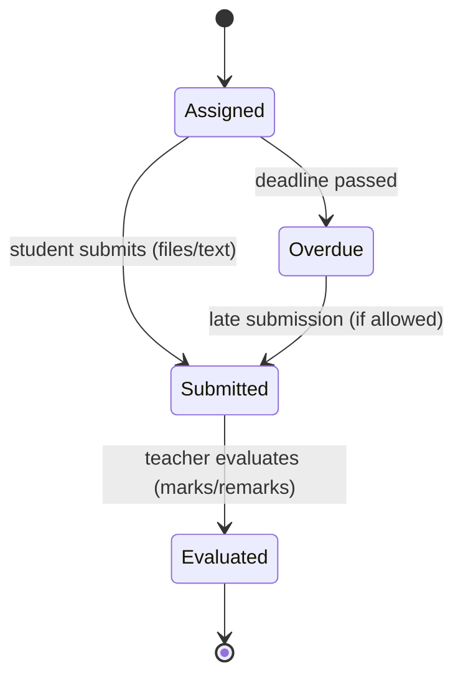

# WF-04 Daily Diary — classwork and homework per period

| Field | Detail |
|---|---|
| Actors | Teacher (writes), substitute teacher, Students/Parents (read, submit homework), Coordinators (reports) |
| Trigger | Teacher takes a period (timetable) |
| Preconditions | The teacher has timetable periods (`/timetable/teacher-timetable/`); lesson plan is mapped for grade-subject (LP badge) |
| Evidence | O: `/erp/diary` shows a week strip (Mon–Sat), "Ongoing & Upcoming" period cards (P#, start/end time, Grade-Section chip, subject, LP button), actions "+ Homework for another class", "Annual Lesson Plan", "Refresh". `GET /school-feed/my-diary-given/?acad_session&start_date&end_date&page_num&page_size` → entries `{title, classwork, homework, has_homework, media_files[], is_online, is_substitute, last_submission_dt, created_at, sections[], subjects[]}`. S: `/academic/create-dairy/`, `/academic/dairy-upload/`, `/academic/assign-homework-dairy/`, `/lesson_plan/v2/upcoming-period-data/`, diary reports by grade/section/subject/teacher |

## Steps
1. Teacher opens Diary; the current week and today are preselected. (O)
2. The period list comes from the teacher's timetable for the day, including substitute periods. (O data)
3. For a period the teacher opens the entry. The lesson-plan resources for that period are suggested (LP button → lesson plan view). (O button, S endpoint)
4. Teacher enters **classwork** (what was done) and optional **homework** text, attaches media, and sets the **homework submission deadline** (`last_submission_dt`). An online-submission flag is available (`is_online`). (O fields)
5. One diary entry can target multiple sections/subjects (arrays). (O)
6. "Homework for another class" creates an entry for a class outside the teacher's periods (e.g. covering). (O button)
7. On save, students/parents of those sections are notified (I); students see the homework under Today/Pending; on submission it moves to Submitted, and after teacher evaluation to Evaluated (S student homework endpoints).
8. Coordinators view diary completion reports (grade → section → subject → teacher). (S)

## Business rules
- BR-DIA-1: A diary entry belongs to (teacher, date, period?, sections[], subjects[]); `is_substitute=true` when written by a substitute. (O)
- BR-DIA-2: `has_homework` is derived from non-empty homework. (I)
- BR-DIA-3: Submission after `last_submission_dt` is marked late or blocked (UNKNOWN which; PROPOSED: allowed and flagged late).
- BR-DIA-4: Diary completion % = periods with an entry ÷ periods taught (report). (I)

## States (homework submission, from student endpoint names)

## Related
Entities: DiaryEntry, DiaryMedia, HomeworkSubmission, Period, TeacherPeriod, LessonPlanPeriod. Permissions: `diary.write` (own periods), `diary.write.any_class`, `diary.view.reports`.
