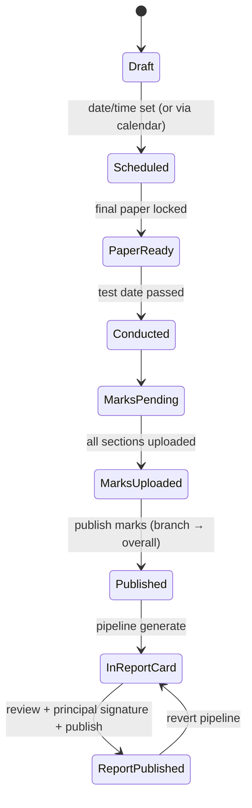

# WF-06 Assessment lifecycle and report cards

| Field | Detail |
|---|---|
| Actors | Academic Ops/ACMS (create assessments, blueprints, papers), Teachers (upload marks, evaluate online tests), Principal (signature, publish), Students (attempt online tests, view results), Parents (view report cards) |
| Evidence | O: `GET /acms/assessments/?branch_id&session_year&date_filter&sort_dir&page` → `{code, name, test_type(+display), section_access, grade, subject, test_date, test_time, scheduled_via_calendar, calendar_event_id, effective_test_date, total_marks, duration_minutes, status(+display), practice_paper_count, sample_paper_count, has_final_paper, final_paper_locked, has_blueprint…}`; `GET /acms/assessments/marks_upload_dashboard/?tab&branch_id&session_year&paginate_by` → `{name, code, grade, subject, test_date, result_date, is_overdue, is_urgent, days_remaining, marks_published, assessment_mode, teacher_pdf_url, branch_assignment_id, branch_marks_published, online_pending_sync, online_pending_grading, section_mapping_id…}`; `GET /acms/assessments/my-access/` → `{scope, user_level, grades[], subjects[]}`; `GET /assessment/exam-type-list/`; `GET /erp_user/principle-signature/`; `/assessment/report-card-question-category-mapping/`. S: question bank, question papers (create/publish/auto-generate), `/assessment/upload-marks/`, `/assessment/upload-omr-result-excel/`, grading systems, report-card components/sub-components/config, report-card **pipeline** (status, publish status, revert), hall tickets, personality traits, student grades |

## Steps
1. Configure **exam types** (e.g. Weekly Test, Pre-Board, Term) and **grading systems** (mark ranges → grades). (O/S)
2. Create an **assessment** per grade × subject: code, name, test type, date/time (or schedule via a calendar event), total marks, duration, mode (online/offline), and section access. (O)
3. Prepare papers: blueprint (marks distribution by chapter/topic/difficulty), **practice** and **sample** papers, and a **final** paper that is locked before the test. Papers come from the question bank (central or school), with auto-generation available. (O/S)
4. Assign to branches (`branch_assignment_id`); a teacher PDF of the paper becomes available. (O: `branch_assignment_id` and `teacher_pdf_url` fields; I: their meaning)
5. Conduct: offline (printed or OMR) or online (student attempt with optional proctoring; `online_pending_sync`/`online_pending_grading`). (O/S)
6. **Marks entry**: teachers upload marks per section (manual grid, Excel/OMR bulk). The dashboard shows overdue/urgent by `result_date`. (O)
7. **Publish marks** per branch (`branch_marks_published`) and overall (`marks_published`). (O)
8. **Report-card pipeline**: map assessments to report-card categories/components with weights, generate per student, review, and publish (pipeline statuses; revert possible). Principal signature is applied. (S/O)
9. Students and parents view results and report cards; analytics (performance analytics, individual student report, comparison). (S)

## Business rules
- BR-AS-1: Marks ≤ total marks; absent/exempt codes allowed (PROPOSED: AB, EX, ML).
- BR-AS-2: The final paper must be locked before the test date; locked papers are read-only. (O field)
- BR-AS-3: `is_overdue` when today > result_date and marks are not published; `is_urgent` when days_remaining ≤ threshold. (O fields; threshold UNKNOWN)
- BR-AS-4: A teacher's scope (`my-access`) limits the grades and subjects they can see/upload. (O)
- BR-AS-5: Report-card generation requires all mapped assessments to be published (I).

Entities: ExamType, GradingSystem, Assessment, AssessmentBranchAssignment, Blueprint, QuestionPaper, Question, Chapter, Topic, MarksEntry, ReportCardConfig, ReportCardComponent, ReportCardPipeline, PrincipalSignature. Permissions: `assessment.create`, `assessment.paper.manage`, `assessment.marks.upload` (scoped), `assessment.marks.publish`, `reportcard.configure`, `reportcard.publish`.
