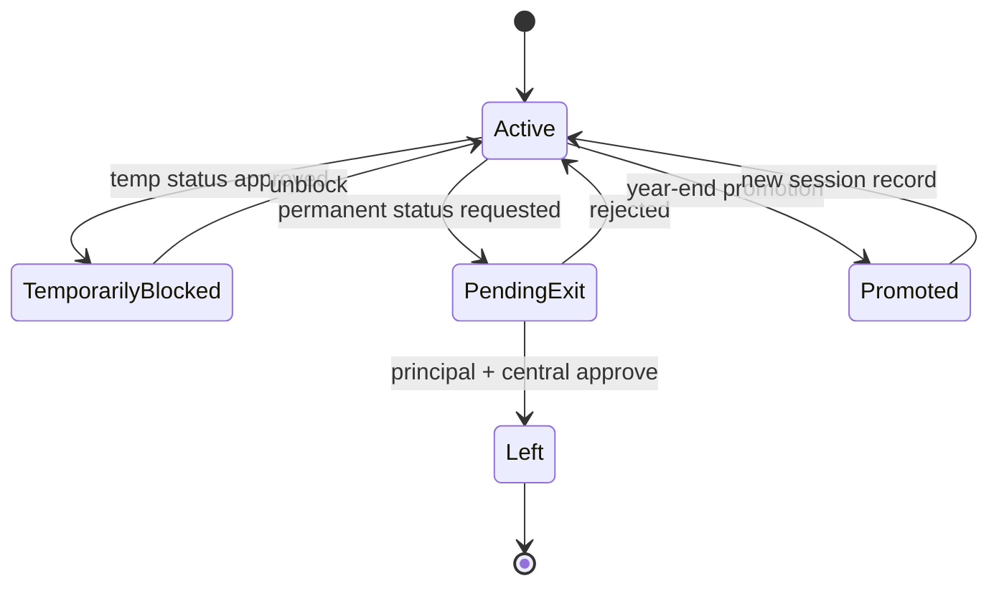

# WF-08 Student lifecycle changes with approval

Evidence: STATIC (Students menu and Approvals menu; routes `/student-shuffle-request`, `/user-management/section-shuffle`, `/bulk/student-type`, `/student-promotion`, `/student/access-blocker`, `/student/access-blocker-request`, `/student/manage-permanent-student-status`, `/approval-request/permanent-status-request`, `/approval-request/permanent-status-request-principle`, `/approval-request/student-shuffle-request`, `/approval-request/student-type-change-request`, `/user-management/tc-request`, `/shuffle-report`, `/temporary-status-report`; endpoints `/erp_user/user-mgmt/student-status/`, `/student-session/`, `/acms/section-carry-forward/*`). Confidence MEDIUM.

| Change | Request → Approver(s) | Effect |
|---|---|---|
| Section shuffle (move between sections of the same grade) | Requester (admin/coordinator) → approval | Updates the student's section mapping for the session; history kept (shuffle report) |
| Student type change (e.g. regular ↔ staff ward) | Request → approval | Affects the fee plan |
| Temporary status (access blocker, e.g. fee default or discipline) | Request → approval | Blocks app access / online class (`onine_class_access_blocker_check`) |
| Permanent status (left, TC issued, dropout) | Request → Principal approval → central approval | Student inactive; TC request flow |
| Promotion | Bulk at year end | New student-session record in the next grade |
| Transfer certificate | TC request → approval → issue | Document generated; status set to Left |

