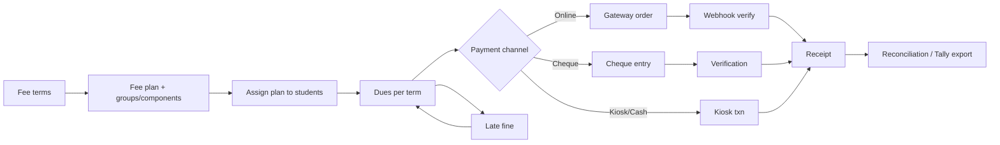

# WF-09 Fee configuration, assignment, collection and receipts

Evidence: STATIC only (routes and menu labels; finance APIs live on a separate service, `orchids.finance.letseduvate.com/qbox/apiV1|apiV2`, whose catalog sits in lazy chunks that were not loaded). The teacher account has no Finance access, so nothing was observed at runtime. Confidence: MEDIUM for structure, LOW for rules.

| Field | Detail |
|---|---|
| Actors | Accountant / Finance admin (configure, collect, approve), Parent (pay online), Kiosk (self-service payment), Principal/Finance head (approvals) |
| Static evidence | Routes: `/student-fee/fee-term`, `/fee-plan`, `/fee-group(-typewise)/…/:feePlanId`, `/multi-fee-group-form`, `/other-fee-type`, `/misc-fee`, `/multi-other-fee-assign`, `/student-fee-structure`, `/student-dues`, `/fee-payment-form/:erpId/:studentId`, `/combined-fee-payment-form/…`, `/student-fee-payment/:orderIdValue`, `/fee-receipt/:erpId/:id`, `/installment-fee-receipt`, `/due-fee-receipt`, `/misc-fee-receipt`, `/payment-history`, `/cheque-payment`, `/kiosk-*`, `/cash-deposit-machine`, `/fine-config`, `/fine-request`, `/promote-fee-structure`, `/promote-back-dues`, `/fee-demand-notice(-termwise)`, `/master-management/fee-settings`, `/last-date-settings`, `/receipt-settings`, `/bank-fee-account`, `/fee-management/reconciliation`; dashboards (collection, late fine, net paying strength) |

## Steps (reconstructed)
1. **Masters**: bank/fee accounts, receipt settings (numbering, templates), last-date settings, fee popup settings (I: payment reminders shown to parents on login, "fee-defaulters-banner" endpoint O in profile group).
2. **Fee terms** (installment schedule, e.g. Q1–Q4 with due dates). (S)
3. **Fee plan** per session/branch/grade (and student type, e.g. new/existing, staff ward) with **fee groups** = components (tuition, admission, curriculum/books, transport, SEN, misc) and amounts per term ("typewise"). (S)
4. **Assign** a plan to students (bulk by grade or individual); plan changes go through approval ("Fee Plan Change" request). (S)
5. **Collect**: online by parent (payment gateway, order id → success page), cheque (with verification and bounce handling), kiosk/cash deposit machine, offline receipt requests. Partial and installment payments allowed. (S)
6. **Receipt** generated per payment (type-specific receipts). (S)
7. **Fines** for late payment per fine config; fine waiver via fine request (approval). (S)
8. **Dues and demand notices** termwise; follow-up calling workflows (fee reminder dashboards, assigned follow-ups). (S)
9. **Reconciliation** of gateway/bank settlements against receipts; Tally export. (S)
10. **Year-end**: promote fee structure to the next session; carry back-dues forward. (S)

## Business rules (PROPOSED where UNKNOWN)
- BR-FEE-1: Amount due = Σ(plan components for terms due) − concessions + fines − payments; never negative; overpayment goes to the wallet.
- BR-FEE-2: Receipt numbers are unique and sequential per branch/session/account (configurable prefix).
- BR-FEE-3: Payments are immutable; corrections via cancellation/refund with approval (S: approve fee cancel / curriculum fee cancel / transport fee cancel).
- BR-FEE-4: Online payments are confirmed only by verified gateway webhook (idempotent).
- BR-FEE-5: Fine = per-day or flat after the last date, capped (config).

