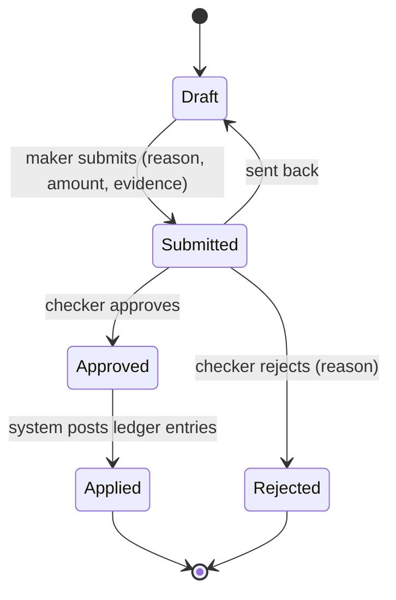

# WF-10 Concessions, refunds and wallets (maker–checker)

Evidence: STATIC (routes, menu labels, finance endpoints for sibling concessions). Confidence MEDIUM.

- **Concessions**: master concession types (`/student-fee/master-concession`), raise a concession for a student (`/raise-master-fee-concession`), approve (`/approve-concession`), bulk upload (`/bulk/concession-upload`), and **sibling concession** with Aadhaar-based sibling matching, a policy, assign-preview, approvals and a dashboard (`/apiV1/sibling-concession/*` on finance, STATIC HIGH).
- **Wallets**: academic wallet, store wallet, transport wallet and imprest wallet; transactions; refund requests (`/wallet-refund-request`, `/academic-wallet-refund-request`, `/store-wallet-refund-request`, `/imprest-refund-request`), approval requests (`/approval-request/wallet-request`, `store-wallet-request`, `transport-wallet-request`), pay requests (`/approve-pay-request`, `/imprest-pay-request`, `/store-pay-request`).
- **Cancellations**: fee, curriculum fee and transport fee cancellations need approval.
- **SEN opt-out** approval (`/approve-sen-opt-out`).

## Generic maker–checker flow (PROPOSED canonical model)

Rules: maker ≠ checker; approval thresholds by amount; every transition audited; applied financial effects are ledger entries (never in-place edits).
