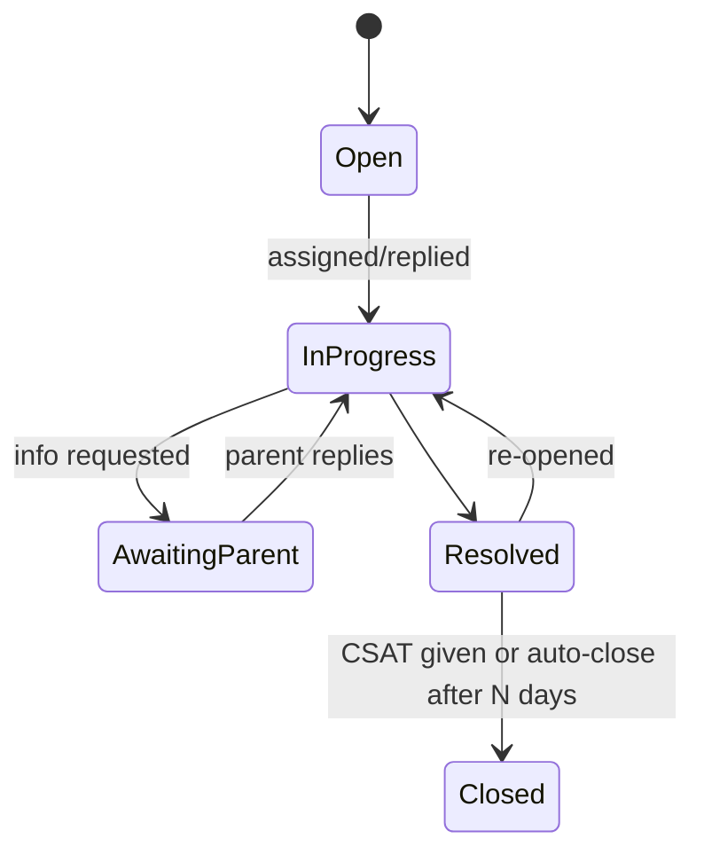

# WF-12 Parent helpdesk ticket

Evidence: STATIC (routes `/ticket`, `/ticket-config`, `/ticket-dashboard`, `/ticket-report`, `/ticket-view/:id`, `/ticket/:label/:branchIds/:startDate/:endDate/:csatScore`, `/refund-ticket`; finance `/apiV1/ticket/`). Runtime details in `api_contracts.md#tickets` when captured. Confidence MEDIUM.

1. Parent (or staff on their behalf) raises a ticket: category/sub-category (configured in Ticket Config), description, attachments. (S)
2. Routing to the responsible staff by category and branch (config). (I)
3. Staff reply in a thread; status changes (Open → In Progress → Resolved → Closed; re-open allowed) (PROPOSED statuses; originals UNKNOWN).
4. On resolution the parent gives a **CSAT score** (dashboard filter by CSAT). (S)
5. Dashboards and reports by label, branch, date range and CSAT; SLA tracking (PROPOSED).
6. Refund tickets are a specialised category linked to finance refunds. (S)

