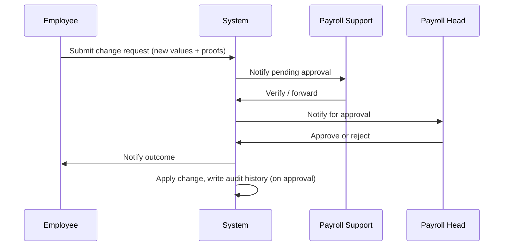

# WF-14 Sensitive staff-profile change with approval

| Field | Detail |
|---|---|
| Actors | Employee (requester), Payroll Support / Payroll Head (approvers) |
| Evidence | O: HRMS Profile shows the info alert "To update Aadhaar, PAN, Bank details, use the 'Aadhaar, PAN & Bank' tab in Edit Profile. Changes will be sent for approval to Payroll Support / Payroll Head." Masked values with reveal buttons. S: `/edit-profile` route, `/payroll/employee-details-update-approval`, `profileUpdate` endpoints, HRMS `user-activity-history` |

## Steps
1. Employee opens Edit Profile → "Aadhaar, PAN & Bank" tab. (O text)
2. Edits values and uploads proofs (I). Submission creates a **change request**; the live profile is not changed yet. (O text)
3. Payroll Support reviews; Payroll Head approves or rejects (two approver roles named; sequence UNKNOWN). (O)
4. On approval the profile is updated and the activity history records the change. (S/I)
5. On rejection the employee is notified with a reason (I).

## Rules
- BR-PR-1: Fields are masked by default (`********1234` (synthetic example)); reveal requires permission and is audited (PROPOSED for the audit part).
- BR-PR-2: Non-sensitive fields (address, emergency contact) may be updated directly or with lighter approval (UNKNOWN).

