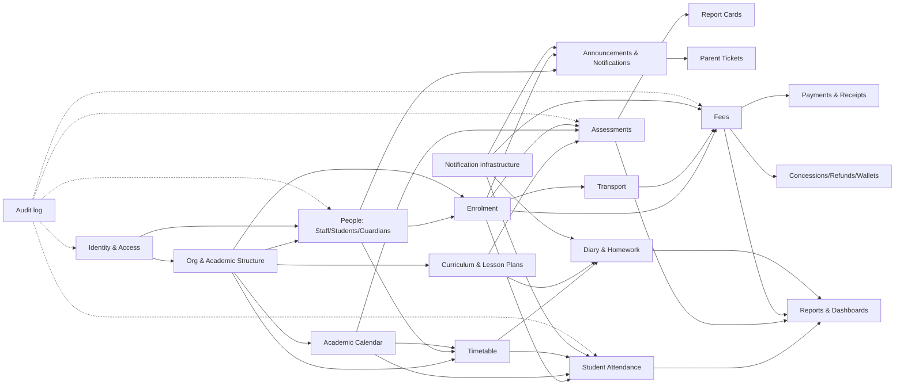

# Module Dependencies

| Module | Hard dependencies | Soft dependencies |
|---|---|---|
| Identity & Access | — | Audit |
| Org & Academic Structure | IAM | — |
| People | IAM, Org | — |
| Enrolment | People, Org | Fees (plan assignment) |
| Academic Calendar | Org | Assessments (link) |
| Timetable | Org, People (staff), Calendar (holidays) | Substitution ← Staff leave |
| Curriculum & Lesson Plans | Org | Timetable (period mapping) |
| Diary & Homework | Timetable, People, Enrolment | Lesson plans, Notifications |
| Student Attendance | Enrolment, Calendar | Timetable (period-wise), Notifications |
| Assessments | Org, Enrolment, Curriculum | Calendar, Question bank |
| Report Cards | Assessments, Grading | Principal signature (Org) |
| Announcements/Notifications | People, Enrolment | Channels (email/SMS/push/WhatsApp) |
| Parent Tickets | People, Enrolment | Notifications |
| Fees | Enrolment, Org | Transport, Concessions |
| Payments | Fees | Gateway |
| Transport | Enrolment, Org | Fees, GPS |
| Reports | all producers | — |
