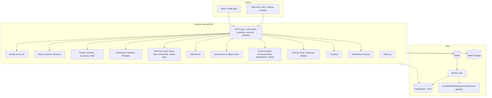

# Recommended Architecture for the Independent Replacement

Status: PROPOSED. **Scope: the REPLACEMENT system.** For the original's architecture see `04_BACKEND_ANALYSIS/backend_architecture.md` and `02_FRONTEND_ANALYSIS/technology_stack.md`. Based on the findings, but deliberately **not** a copy of the original topology (three SPAs, about 10 HTTP services, Mongo + SQL, client-side permission matrix, secrets in bundles).

## 1. Decision: modular monolith (not microservices)
| Criterion | Modular monolith | Microservices (original style) |
|---|---|---|
| Team size (assumed 2–8 devs) | ✅ one deployable, one repo | ❌ high coordination and ops overhead |
| Cross-module transactions (enrolment + fees, attendance + notifications) | ✅ ACID in one DB | ❌ sagas/eventual consistency |
| Consistent authz and tenancy | ✅ one enforcement layer | ❌ re-implemented per service (the original shows `X-DTS-BRAND` plumbing) |
| Scalability need | ✅ sufficient: stateless app + read replica + workers | ✅ but premature |
| Future extraction | ✅ module boundaries allow extracting e.g. Notifications or Reporting later | — |

**Decision:** one backend codebase with strict internal modules, one PostgreSQL database (schema-per-module or table prefixes), a worker process for async jobs, and one web frontend.

## 2. Technology stack (recommended)
| Layer | Choice | Why |
|---|---|---|
| Language | **TypeScript end-to-end** | shared types and validation schemas between API and UI; large talent pool |
| Backend framework | **NestJS** (or Fastify + modular structure) | module system maps to bounded contexts; DI; guards for RBAC |
| ORM / DB access | **Prisma** or **Drizzle** on **PostgreSQL 16** | migrations, type safety; Postgres RLS for tenant isolation |
| Validation / contracts | **Zod** schemas → OpenAPI 3.1 generation | single source for request/response contracts |
| Auth | Own auth module (Argon2id, JWT access + rotating refresh in httpOnly cookies, OTP/TOTP) or a self-hosted IdP (Keycloak/Ory) if SSO is needed | |
| Jobs / queue | **BullMQ** on Redis (or pg-boss to avoid Redis initially) | notifications, imports/exports, report cards, reminders |
| Files | S3-compatible object storage + signed URLs | |
| Frontend | **React 18 + Vite + TypeScript**, **TanStack Router/Query**, **Ant Design 5** (or MUI) | matches observed UX patterns; Query cache removes duplicate calls |
| Forms | React Hook Form + Zod | |
| Charts | Apache ECharts or Recharts | |
| PDF | Server-side HTML→PDF (Playwright/Chromium) for receipts and report cards | |
| Notifications | Provider abstraction: email (SES/SMTP), SMS (Indian DLT-compliant gateway), WhatsApp Business API, FCM push | |
| Payments | Gateway abstraction (Razorpay/Stripe-style) with webhook verification | |
| Observability | OpenTelemetry, structured logs (pino), Sentry | |
| Testing | Vitest/Jest (unit), Supertest + Testcontainers (integration), Playwright (e2e) | |
| Mobile (later) | PWA first; React Native/Expo reusing the API | |

~~An equivalent Python stack (Django + DRF + Celery + React) is acceptable.~~ **Withdrawn (audit ER-40):** the replacement is TypeScript end to end (React + NestJS + PostgreSQL). Reviving a Python stack needs an owner-approved ADR. The original's use of Django is INFERRED and is not a reason to match it.

## 3. Logical architecture

## 4. Multi-tenancy design
- Hierarchy: **Tenant (school group) → Branch (one school campus; optional Zone and City groupings, independent of each other) → Academic year → Grade offering → Class section → Class subject** (audit ER-41).
- Every tenant-owned row has `tenant_id`; PostgreSQL **Row-Level Security** policies use `current_setting('app.tenant_id')` set per request/transaction. Branch and year scoping is applied in services via the user's role-assignment scopes.
- Tenant resolution: custom domain or subdomain → tenant; users belong to one tenant (multi-tenant users via separate memberships if needed).
- Tenant branding: logo, primary colour, name (the original supports `primary_color` per brand).

## 5. RBAC design
- Permission catalogue in code (`attendance.mark`, `attendance.view`, `diary.write`, `fees.collect`, …) shared with the frontend for menu building.
- Roles are tenant-configurable bundles of permissions; seed system roles: Super Admin, School Admin, Principal, Academic Coordinator, Class Teacher, Subject Teacher, Accountant, Transport Manager, Front Office, Parent, Student.
- Role assignments carry a **scope** (tenant / branch / grade / class section / subject) and an academic year.
- Data-level rules: teachers only see classes in their scope; parents only their children; students only themselves.
- Navigation = filter of a static nav registry by permissions (single source; no hard-coded user IDs).

## 6. API design
- REST + JSON, resource-oriented, `/api/v1/...`, plural nouns, kebab-case paths, camelCase JSON (or snake_case; pick one and be consistent — the original mixes them).
- Standard envelope for errors only (`{error: {code, message, details[], requestId}}`); success returns the resource or `{data, page}` for lists.
- Pagination `?page=&pageSize=` (max 200) returning `{data, page: {number, size, total}}`; filtering via explicit query params; sorting `?sort=field,-field`.
- Context headers are **not** needed: branch/year are explicit query params or path segments, validated against scope.
- Bulk endpoints for attendance and marks; idempotency keys on payment and bulk writes.
- OpenAPI generated from Zod schemas; contract tests in CI.

## 7. Cross-cutting
- Audit log module (append-only), with domain events (`AttendanceMarked`, `MarksPublished`, `PaymentReceived`) dispatched in-process; an outbox table feeds the worker for notifications.
- Reporting: SQL views/materialised views per dashboard; async export jobs to CSV/XLSX/PDF.
- File handling: upload → object storage (pre-signed PUT) → virus scan job → attach.
- i18n-ready UI (English first; Hindi/regional later — the original has language selection config).
- Feature flags per tenant (modules on/off: transport, online class, finance).
